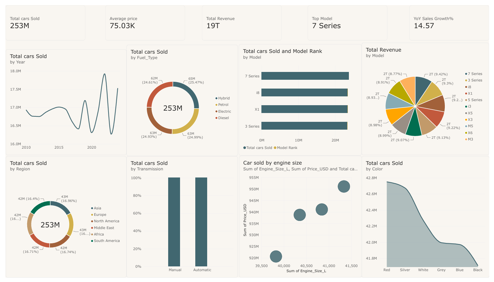

# 🚗 BMW Car Sales Dashboard (Power BI)

An interactive Power BI dashboard that analyses BMW car sales by model, region, fuel type, transmission, colour and year. It is built on the **BMW Car Sales Classification** dataset from Kaggle.

---

## 📌 Project Overview

This project turns raw BMW sales records into a clear, interactive view that answers questions like:

- How many cars were sold, and how much revenue did they generate?
- Which BMW models and regions perform best?
- How are sales split across fuel types, transmissions and colours?
- How have sales changed from year to year?
- How do engine size and price relate for each fuel type?

---

## 📊 Dashboard Contents

### KPI Cards
| KPI | Description |
|---|---|
| **Total Cars Sold** | Total sales volume |
| **Average Price** | Average car price (USD) |
| **Total Revenue** | Total revenue generated |
| **Top Model** | Best-selling BMW model |
| **YoY Sales Growth %** | Year-over-year change in sales |

### Visuals
| Visual | Chart Type | Insight |
|---|---|---|
| Sales by Year | Line chart | Sales trend over time |
| Sales by Region | Donut chart | Regional contribution |
| Top 5 Models | Bar chart | Best-performing models |
| Sales by Fuel Type | Donut chart | Fuel type share |
| Sales by Transmission | 100% stacked column | Manual vs automatic |
| Revenue by Model | Pie chart | Revenue share per model |
| Engine Size vs Price | Scatter chart | Price vs engine size by fuel |
| Sales by Colour | Stacked area chart | Colour preferences |

---

## 🧱 Data Model (Star Schema)

- **Fact table:** `FactSales`
- **Dimension tables:** `DimModel`, `DimRegion`, `DimYear`, `DimFuel`, `DimTransmisson`, `DimColor`

## 🧮 DAX Measures

`Total cars Sold` · `Total Revenue` · `Average price` · `Model Rank` · `Top Model` · `YoY Sales Growth%`

---

## 🛠️ Tools Used

- Power BI Desktop
- Power Query
- DAX
- Star schema modelling

---

## 🚀 How to Use

1. Download or clone this repository.
2. Install [Power BI Desktop](https://powerbi.microsoft.com/desktop/) (free, Windows).
3. Open `Dashboard_BMW.pbix` and explore the visuals.

---

## 🔍 Key Insights

- Best-selling model: …
- Top region: …
- Most popular fuel type: …
- Peak sales year: …

---

## 👤 Author

**Your Name**
- GitHub: [@sangeethkumar1314-bot](https://github.com/sangeethkumar1314-bot)
